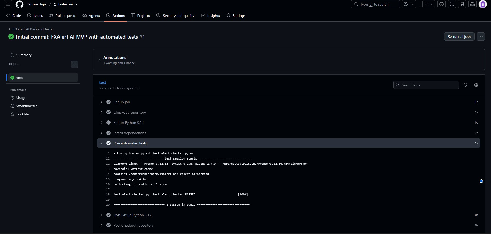

# FXAlert AI — 匯率查詢與提醒系統

FXAlert AI 是一個使用 Python FastAPI 開發的匯率查詢與提醒系統。

這次選擇匯率作為專案主題，是因為平常在換外幣時，除了想知道目前的匯率，也會想查看近期走勢，以及匯率是否達到自己設定的目標。

因此，我透過 Frankfurter API 取得匯率資料，製作了貨幣換算、歷史走勢圖及匯率提醒功能，並使用 SQLite 儲存提醒條件。

## 1. 主要功能

- **匯率查詢與換算**：支援 USD、TWD、MYR、JPY、EUR 五種貨幣。
- **歷史匯率走勢**：使用 Chart.js 顯示最近 7、30、90 天的匯率變化，並計算最高、最低匯率與漲跌幅。
- **匯率提醒管理**：透過 FastAPI Swagger UI 新增、查詢、修改及刪除提醒。
- **條件判斷**：支援 `>=` 和 `<=`，可手動檢查匯率是否達到目標。
- **防止重複觸發**：當匯率持續達標時，不會重複產生新的提醒事件。

目前匯率提醒採手動檢查方式，尚未實作自動排程或 Email 通知。

## 2. 使用技術

| 類別 | 技術 |
|---|---|
| Backend | Python、FastAPI |
| Frontend | HTML、CSS、JavaScript、Bootstrap |
| 圖表 | Chart.js |
| Database | SQLite |
| 匯率來源 | Frankfurter API v2 |
| Testing | Pytest |
| Version Control / CI | Git、GitHub、GitHub Actions |

## 3. 如何執行

**Step 1：下載專案**

```bash
git clone https://github.com/James-zhijia/fxalert-ai.git
cd fxalert-ai/backend
```

**Step 2：建立並啟動虛擬環境（Windows PowerShell）**

```powershell
python -m venv .venv
.\.venv\Scripts\Activate.ps1
```

**Step 3：安裝套件**

```powershell
pip install -r requirements.txt
```

**Step 4：啟動 FastAPI**

```powershell
python -m uvicorn app.main:app --reload
```

啟動後可開啟：

- [Dashboard](http://127.0.0.1:8000/dashboard/) — 匯率換算與歷史走勢圖
- [Swagger UI](http://127.0.0.1:8000/docs) — API 測試與提醒管理

## 4. API 功能

| Method | API | 功能 |
|---|---|---|
| GET | `/api/rates/latest` | 查詢參考匯率 |
| GET | `/api/convert` | 貨幣換算 |
| GET | `/api/rates/history` | 歷史匯率 |
| POST | `/api/alerts` | 新增提醒 |
| GET | `/api/alerts` | 查詢提醒 |
| PUT | `/api/alerts/{alert_id}` | 修改提醒 |
| DELETE | `/api/alerts/{alert_id}` | 刪除提醒 |
| POST | `/api/alerts/check` | 檢查提醒條件 |

## 5. 測試與 GitHub Actions

本專案使用 Pytest 測試匯率條件判斷，包含首次達標、持續達標不重複觸發，以及再次達標等情境。

在 `backend` 資料夾執行：

```powershell
python -m pytest test_alert_checker.py -v
```

另外，也設定 GitHub Actions，在程式碼 Push 至 GitHub 時自動執行測試。

**GitHub Actions 測試結果：1 passed**



[查看 GitHub Actions 測試紀錄](https://github.com/James-zhijia/fxalert-ai/actions/runs/42362778733)

## 6. AWS 雲端架構規劃

目前系統使用 FastAPI 和 SQLite 在本機執行。

如果未來要部署到雲端，我規劃使用 S3、CloudFront 提供前端網站，透過 API Gateway 和 Lambda 執行後端程式，並使用 DynamoDB 儲存提醒資料。

另外，也可以整合 EventBridge Scheduler 定期檢查匯率，以及 SNS 發送通知。

[查看 AWS 架構設計圖](docs/aws-architecture.md)

**目前 AWS 部分僅完成架構設計，尚未實際部署。**

## 7. 後續改進方向

- 將提醒管理功能整合進 Dashboard。
- 加入自動排程與 Email 通知。
- 將系統部署至 AWS。
- 增加 API 與資料庫整合測試。

---

**備註：** 本系統使用 Frankfurter 提供的參考匯率，並非即時交易報價，僅供學習與展示用途。