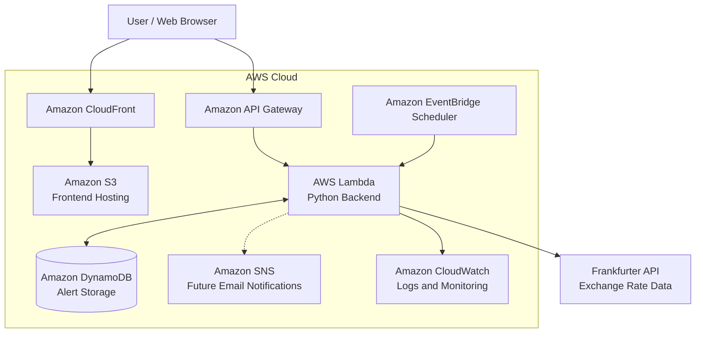

# FXAlert AI — AWS Cloud Architecture

## Proposed Cloud Architecture

This architecture is a proposed AWS deployment design.
The current MVP runs locally using FastAPI and SQLite.



## AWS Services

| Service | Purpose |
|---|---|
| Amazon S3 | Host static frontend files |
| Amazon CloudFront | Deliver frontend content |
| Amazon API Gateway | Expose backend API endpoints |
| AWS Lambda | Execute Python backend logic |
| Amazon DynamoDB | Store exchange rate alert settings |
| EventBridge Scheduler | Schedule periodic alert checks |
| Amazon SNS | Send future email notifications |
| Amazon CloudWatch | Collect logs and monitor errors |

## Current Implementation vs AWS Proposal

### Currently Implemented

- FastAPI backend running locally
- SQLite database for alert storage
- Frankfurter exchange rate API integration
- Currency conversion and historical rate charts
- Alert CRUD operations
- Manual alert checking and duplicate-trigger prevention
- GitHub Actions automated testing

### Proposed Future Deployment

- Deploy frontend using S3 and CloudFront
- Adapt FastAPI endpoints to Lambda and API Gateway
- Migrate alert storage from SQLite to DynamoDB
- Add scheduled alert checks with EventBridge Scheduler
- Integrate SNS for email notifications
- Monitor cloud operations using CloudWatch

## Notes

AWS services shown in this architecture have not been deployed.
The diagram represents a proposed serverless cloud architecture.
```
