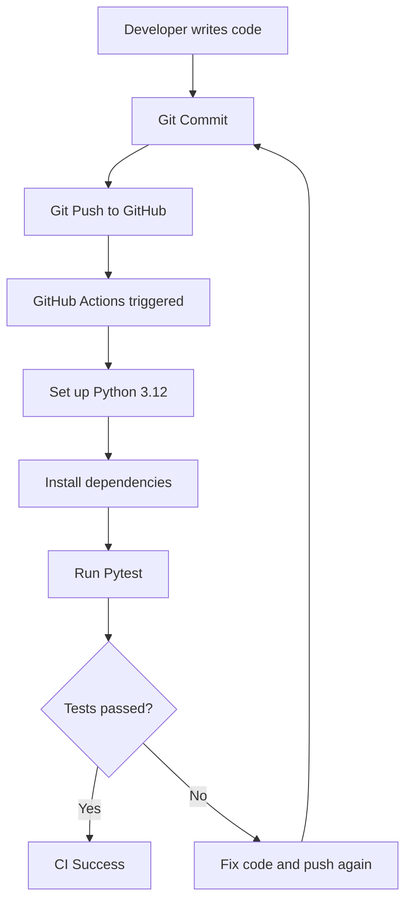

# FXAlert AI — CI/CD Workflow

## CI Workflow

This project uses GitHub Actions for automated testing.

## Current Implementation

- GitHub Actions runs automatically on Push and Pull Request.
- Python 3.12 is installed in the CI environment.
- Dependencies are installed from requirements.txt.
- Pytest checks exchange rate alert conditions.
- Test results are displayed in GitHub Actions.

## Future CD Plan

After CI tests pass, the project could be extended
with an automated deployment pipeline for AWS.

The current project implements CI only.
Automated cloud deployment (CD) has not been implemented.
