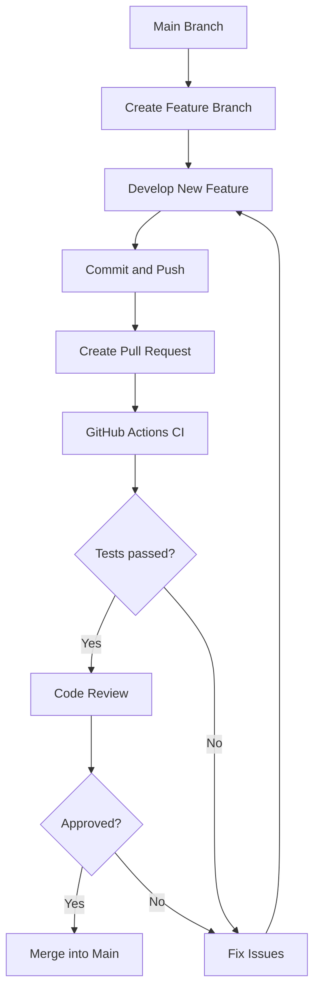

# FXAlert AI — Git Collaboration Workflow

## Proposed Team Collaboration Workflow

## Workflow Explanation

1. Developers create separate feature branches from main.
2. Each developer works on an individual feature.
3. Changes are committed and pushed to GitHub.
4. A Pull Request is created for review.
5. GitHub Actions runs automated tests.
6. After tests pass and the code is approved, changes are merged into main.

## Notes

This is a proposed workflow for team collaboration.

The current FXAlert AI project was developed individually.
Git version control and GitHub Actions CI have been implemented.
